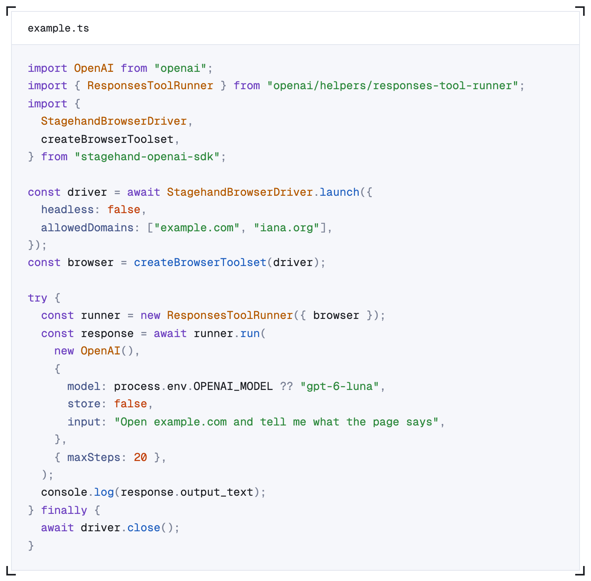
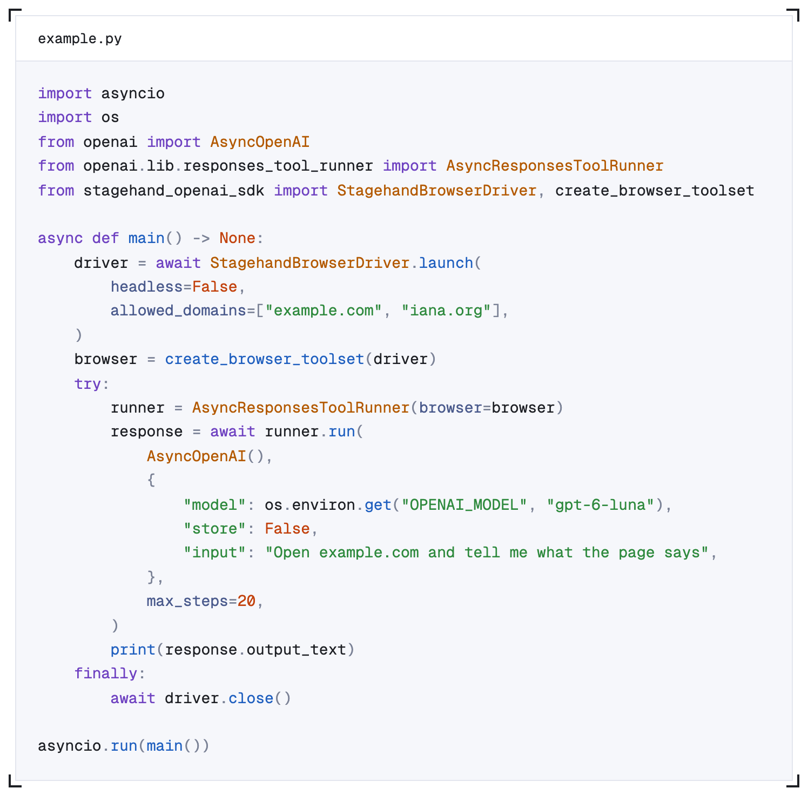

# OpenAI Toolset

Give GPT a browser through the OpenAI SDK. `StagehandBrowserDriver` uses [Stagehand](https://stagehand.dev) to handle navigation, page reading, screenshots, and page interactions behind OpenAI's browser toolset, while the OpenAI SDK's Responses tool runner manages the model's tool loop.

This repository contains TypeScript and Python examples that import the published `stagehand-openai-sdk` packages.

**TypeScript** · [`typescript/example.ts`](typescript/example.ts)



**Python** · [`python/example.py`](python/example.py)



> [!WARNING]
> Demo and reference code only. Browserbase does not claim that any recipe, integration, target, data source, vendor, or workflow in this repository has been vetted, approved, secured, or validated for production use. Independently review the code and obtain all required authorization before running it. You are responsible for compliance, site terms, privacy, security, costs, and outcomes. Use at your own risk.

## Choose your quickstart

| Language | Guide | Requirements | Package |
| --- | --- | --- | --- |
| TypeScript | [TypeScript quickstart](typescript/README.md) | Node.js 22.18+ and pnpm | [npm](https://www.npmjs.com/package/stagehand-openai-sdk) |
| Python | [Python quickstart](python/README.md) | Python 3.11+ and uv | [PyPI](https://pypi.org/project/stagehand-openai-sdk/) |

Both examples open `example.com`, ask the model what the page says, and print its answer. You'll need an OpenAI API key and access to the model you run (`gpt-6-luna` by default; set `OPENAI_MODEL` to change it).

```bash
git clone https://github.com/browserbase/openai-cua-toolset.git
cd openai-cua-toolset
```

Open either language guide for installation, credentials, and run commands. If you've already cloned the repository, start in the corresponding language directory.

Using a coding agent? Point it at [AGENTS.md](AGENTS.md) and it will set up and run the example with you.

## Choose a browser

- **Local Chrome:** Run the examples as written. They launch a visible Chrome window, so install Google Chrome first.
- **Browserbase:** Run without local Chrome by replacing `StagehandBrowserDriver.launch` with `StagehandBrowserDriver.browserbase` and providing a Browserbase API key. Both language guides include the replacement code.

Keep the same driver throughout the tool loop. Close it when the task finishes or fails with `driver.close()`; the toolset and the tool runner never close it.

## Adapt the example

Change the task in `input` and set the model with `OPENAI_MODEL` (or directly in `example.ts` or `example.py`). Update the allowed domains to include the sites your task needs.

| Setting | TypeScript | Python |
| --- | --- | --- |
| Driver import | `stagehand-openai-sdk` | `stagehand_openai_sdk` |
| Toolset | `createBrowserToolset(driver)` | `create_browser_toolset(driver)` |
| Tool runner | `ResponsesToolRunner` | `AsyncResponsesToolRunner` |
| Allowed domains | `allowedDomains` | `allowed_domains` |
| Blocked domains | `blockedDomains` | `blocked_domains` |
| Opt-in tools | `additionalMembers` | `additional_members` |
| Consent hook | `confirm` | `confirm` (`async def`) |
| Chrome executable | `chromePath` | `chrome_path` |
| Step limit | `{ maxSteps: 20 }` | `max_steps=20` |
| Cleanup | `await driver.close()` in `finally` | `await driver.close()` in `finally` |

## Limitations

- Domain lists apply to the browser's HTTP and HTTPS requests and WebSocket handshakes. A domain entry includes its subdomains, and blocked entries take precedence.
- Domain lists don't cover WebRTC or other non-HTTP traffic, so they are a guardrail, not complete network isolation.
- JavaScript dialogs (`alert`, `confirm`, `prompt`, `beforeunload`) are answered automatically and reported to the model; the message is never shown. A `prompt()` is dismissed, and the toolset has no way to type into it.
- The default `confirm` only checks that the browser is alive and the tab exists. Pass your own `confirm` for anything that needs a person or a policy decision.
- Local browsers must be Chromium-based. Firefox and WebKit aren't supported.
- Closed shadow roots aren't read.
- Downloads aren't supported in Browserbase sessions.
- The Python driver is async only.
- If the browser connection is lost, close the toolset and create a new driver.

## Examples

- [TypeScript browser task](typescript/example.ts)
- [Python browser task](python/example.py)

## License

[MIT](LICENSE)
